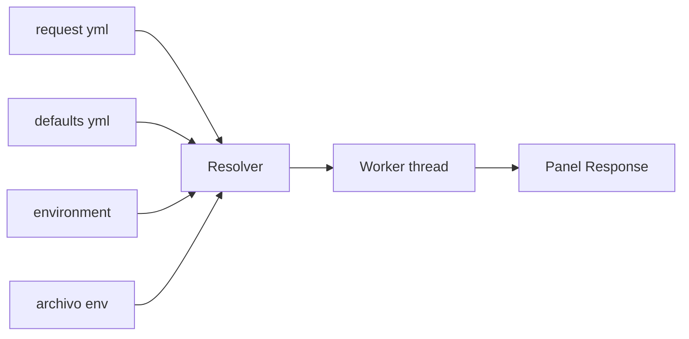

# Requests HTTP

mdnav envía requests HTTP guardados como archivos YAML, al estilo Postman o Bruno, sin salir de la terminal. Cada request es un archivo del repo: se versiona con git y se revisa en un PR como cualquier otro cambio.

## Probalo en un minuto

Esta carpeta de ejemplo trae una collection lista en `DocExample/api`. Abrila con mdnav:

```powershell
mdnav DocExample              # con mdnav instalado
cargo run -- DocExample       # desde el código, parado en la raíz del repo
```

**1. Abrí un request en el HTTP Client**

- Expandí `api` y después `ejemplos` (`j`/`k` para moverte, `Enter` para expandir).
- Seleccioná `01-get-y-cambiar-metodo.yml` y `Enter`: el preview muestra el YAML, con un aviso arriba.
- `Tab` pasa el foco al preview y `Enter` abre el **HTTP Client** con ese request seleccionado. `:@http` hace lo mismo.

El cliente ocupa toda la pantalla: a la izquierda el árbol de collections, folders y requests; a la derecha el detalle del **Request** y, abajo, la **Response**, todavía vacía. `Tab` recorre los tres paneles y solo el enfocado se resalta.

**2. Elegí el environment** (una sola vez: queda guardado en la config)

- `e` abre el selector de environments.
- Bajá hasta `public` con `j` y `Enter`.

El título del panel Request pasa a `env: public` y la URL se muestra resuelta, con la plantilla original abajo en gris.

**3. Enviá**

- `Shift+S`: aparece el spinner en la barra inferior y la response llega con el JSON formateado.
- `Enter` en el árbol salta a la response. Ahí `j`/`k` hacen scroll, `]` cambia a Headers e Info, `y` copia el body y `Esc` vuelve al árbol.

**4. Cambiá algo y reenviá**

- `Shift+E` abre el YAML en tu editor. Cambiá `method: GET` por `method: POST`, guardá y salí: mdnav vuelve al cliente con el mismo request.
- `Shift+S` de nuevo: en la response, `"method"` ahora dice `"POST"`.

Ese ciclo (editar, enviar, mirar la response) es todo el flujo de trabajo. Si te olvidás una tecla, `?` muestra todas las del cliente.

Para probar secretos, creá `DocExample/api/.env` con `DEMO_TOKEN=lo-que-quieras` y enviá `api/echo/post-json.yml`. httpbin devuelve el header `Authorization` que mandaste, y el token nunca aparece en el YAML.

## Ejemplos para aprender

`api/ejemplos/` tiene un request por concepto. Todos van contra httpbin, que te devuelve lo que mandaste: cambiá algo con `Shift+E`, enviá con `Shift+S` y mirá el efecto en la response. Cada archivo explica qué tocar en sus comentarios, y sus docs se ven en el panel Request.

| Archivo | Qué muestra |
|---------|-------------|
| `01-get-y-cambiar-metodo.yml` | el request mínimo y cómo pasar de GET a POST, DELETE, etc. |
| `02-query-y-path-params.yml` | `:id` en la URL, query params encodeados y apagados |
| `03-post-json.yml` | body JSON en varias líneas, con variables adentro |
| `04-post-form.yml` | body de formulario (`form-urlencoded`) |
| `05-headers.yml` | headers propios y los heredados de la collection |
| `06-token-bearer.yml` | **dónde poner tokens**: en el request, en el environment o en `.env` |
| `07-api-key-secreta.yml` | variables `secret: true` y API key en header o query |
| `08-auth-heredada/` | `folder.yml` con auth, headers y variables que heredan sus requests |
| `09-status-timeout-redirects.yml` | colores de status, timeout y redirects |

Para que los ejemplos 06 a 08 usen tus valores, creá `DocExample/api/.env` con:

```
DEMO_TOKEN=lo-que-quieras
demo_api_key=mi-clave
```

## Cómo funciona



- El resolver junta los defaults heredados (`opencollection.yml` y los `folder.yml`: variables, headers y auth), el environment activo y los secretos del `.env`.
- El request sale en un thread aparte: la UI no se congela y `Esc` lo abandona.
- La response queda en memoria por request y sobrevive a `Shift+E` (editar y volver).

## El formato: OpenCollection

Es el formato abierto que Bruno usa de forma nativa (spec en opencollection.com). Que mdnav no tenga un formato propio es a propósito: la misma carpeta se abre en Bruno, y quien no usa mdnav no queda afuera.

```
api/
├── opencollection.yml     # defaults de toda la collection
├── .env                   # secretos (gitignored)
├── environments/
│   └── public.yml
├── github/
│   ├── folder.yml         # defaults del folder
│   ├── get-user.yml
│   └── list-repos.yml
└── echo/
    ├── folder.yml         # auth bearer heredada por sus requests
    └── post-json.yml
```

## Variables y secretos

| Sintaxis | De dónde sale |
|----------|---------------|
| `{{nombre}}` | collection < environment < folders (gana el más específico) |
| `{{process.env.NOMBRE}}` | `.env` de la collection y después el entorno del proceso |
| `secret: true` en un environment | se busca por nombre en `.env` |

El panel Request muestra el request ya resuelto: params, headers, auth (y de dónde se hereda), las primeras líneas del body, settings y docs. Los valores con pinta de secreto (`Authorization`, tokens, API keys, cookies) se ven enmascarados, como `Bearer eyJh…`, y las variables sin resolver quedan en rojo.

Arriba de todo, un bloque **Avisos** junta lo que conviene revisar antes de enviar: variables sin resolver, un environment elegido que ya no existe, `folder.yml` o environments con errores, auth o body no soportados y scripts o assertions que no se ejecutan. Si el YAML no se puede leer, el panel muestra el error en lugar del detalle. En el árbol, un `!` amarillo marca los requests ilegibles o que usan algo que mdnav no envía ni ejecuta.

Al enviar, la barra inferior avisa cuántas variables quedaron sin resolver. Si alguna está en la URL, el request no se envía y mdnav te pide elegir un environment.

## Teclas

Como en el explorador, las acciones que envían o escriben archivos van con Shift. `?` muestra todas las teclas del cliente, empezando por las del panel enfocado.

| Tecla | Acción |
|-------|--------|
| `Enter` en el preview de un request, o `:@http` | abrir el HTTP Client |
| `Tab` / `Shift+Tab` | árbol → request → response |
| `j` `k` / `↑` `↓` | mover en el árbol; scroll en request y response |
| `l` `h` / `→` `←` | abrir y cerrar collections y folders |
| `Enter` en el árbol | en un request, saltar a su response (o al detalle si todavía no tiene) |
| `PgUp` `PgDn` / `g` `G` | scroll rápido; inicio y fin |
| `[` `]` / `h` `l` | tabs de la response |
| `y` | copiar el body |
| `Shift+S` | enviar |
| `Shift+E` | editar el YAML y volver al cliente |
| `Shift+N` | nuevo request en la collection |
| `Shift+C` | nueva collection |
| `Shift+I` | importar el JSON de Postman seleccionado en el explorador |
| `e` | elegir environment |
| `M` | menú: send, env, new, init, import, copy |
| `Esc` | abandonar el request en curso; si no hay, volver al árbol; desde el árbol, cerrar el cliente |
| `q` | cerrar el cliente |
| `?` | ayuda del cliente |

Fuera del cliente, `:httpenv` elige el environment de la collection y `Esc` abandona un request que siga en curso.

## Arrancar una collection propia

- `Shift+C` en el cliente crea una collection en la carpeta que indiques (relativa al root o absoluta): un environment `local`, el `.gitignore` del `.env` y un request de ejemplo. `M` → `init` hace lo mismo con la carpeta seleccionada en el explorador.
- `Shift+N` crea un request en la collection seleccionada en el árbol.
- `Shift+I` (o `M` → `import`) convierte el `*.postman_collection.json` (v2.1) seleccionado en el explorador en una carpeta nueva al lado del JSON. Los `*.postman_environment.json` van a `environments/`, con sus secretos pasados al `.env`.

## Límites actuales

- Los scripts y assertions no se ejecutan; se avisa cuántos hay. Los scripts de Postman quedan como documentación del request.
- Sin bodies multipart ni file, y sin auth OAuth, AWS, digest ni NTLM.

## Siguiente

- [Volver a navegación](02-NAVIGATION.md)
- [Volver al inicio](../00-INTRO.md)
