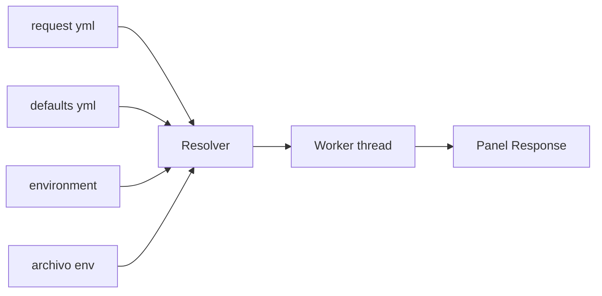

# Requests HTTP

mdnav envía requests HTTP guardados como archivos YAML, al estilo Postman o Bruno, sin salir de la terminal. Cada request es un archivo del repo: se versiona con git y se revisa en un PR como cualquier otro cambio.

## Probalo en un minuto

Esta carpeta de ejemplo trae una collection lista en `DocExample/api`. Abrila con mdnav:

```powershell
mdnav DocExample              # con mdnav instalado
cargo run -- DocExample       # desde el código, parado en la raíz del repo
```

**1. Abrí el estudio**

- `:` abre la palette. Escribí `@http` y `Enter`.
- A la izquierda está la collection. `j`/`k` eligen el request (★ es el abierto). Bajá hasta `GET y cambiar de metodo`.

Si no hubiera collection, la primera pantalla ofrece crear una de ejemplo con Enter. No hay un menú de init ni de import.

**2. Elegí el environment** (una sola vez: queda guardado en la config)

- `e` abre la lista. También podés entrar directo con `:@http env`.
- Bajá hasta `public` con `j` y `Enter`.

En el editor, el título de la collection pasa a `public` y la línea `→` muestra la URL resuelta, `https://httpbin.org/anything/hola`.

**3. Enviá**

- `S`: aparece el spinner y la response llega abajo, con el JSON formateado. El foco pasa a la response.
- `j`/`k` hacen scroll, `]` cambia a Headers e Info, `y` copia el body.

**4. Cambiá algo y reenviá**

- `Tab` vuelve al editor. `m` pasa el método de GET a POST. El archivo se guarda solo: el título dice `guardado` un momento.
- `S` de nuevo: en la response, `"method"` ahora dice `"POST"`.

Ese ciclo (editar en el estudio, enviar, mirar la response) es todo el flujo de trabajo. El YAML queda en el repo, pero no hace falta abrirlo. `Shift+E` sigue ahí para el YAML crudo, si alguna vez lo necesitás.

Para probar secretos, creá `DocExample/api/.env` con `DEMO_TOKEN=lo-que-quieras` y enviá `api/echo/post-json.yml` desde el estudio. httpbin devuelve el header `Authorization` que mandaste, y el token nunca aparece en el YAML.

## Ejemplos para aprender

`api/ejemplos/` tiene un request por concepto. Todos van contra httpbin, que te devuelve lo que mandaste: cambialo en el estudio (`:@http`), enviá con `S` y mirá el efecto en la response. Params, Headers, Body y Auth son pestañas del editor. `Shift+E` abre el YAML si querés ver el archivo.

| Archivo | Qué muestra |
|---------|-------------|
| `01-get-y-cambiar-metodo.yml` | el request mínimo y cómo pasar de GET a POST, DELETE, etc. |
| `02-query-y-path-params.yml` | `:id` en la URL, query params encodeados y apagados |
| `03-post-json.yml` | body JSON en varias líneas, con variables adentro |
| `04-post-form.yml` | body de formulario (`form-urlencoded`) |
| `05-headers.yml` | headers propios y los heredados de la collection |
| `06-token-bearer.yml` | **dónde poner tokens**: en el request, en el environment o en `.env` |
| `07-api-key-secreta.yml` | variables `secret: true` y API key en header o query |
| `08-auth-heredada/` | `folder.yml` con auth, headers y variables que heredan sus requests |
| `09-status-timeout-redirects.yml` | colores de status, timeout y redirects |

Para que los ejemplos 06 a 08 usen tus valores, creá `DocExample/api/.env` con:

```
DEMO_TOKEN=lo-que-quieras
demo_api_key=mi-clave
```

## Cómo funciona



- El resolver junta los defaults heredados (`opencollection.yml` y los `folder.yml`: variables, headers y auth), el environment activo y los secretos del `.env`.
- El request sale en un thread aparte: la UI no se congela y `Esc` lo abandona.
- La response queda en memoria por request y sobrevive a `Shift+E` (el YAML crudo, y al volver se reabre el estudio).

## El formato: OpenCollection

Es el formato abierto que Bruno usa de forma nativa (spec en opencollection.com). Que mdnav no tenga un formato propio es a propósito: la misma carpeta se abre en Bruno, y quien no usa mdnav no queda afuera.

```
api/
├── opencollection.yml     # defaults de toda la collection
├── .env                   # secretos (gitignored)
├── environments/
│   └── public.yml
├── github/
│   ├── folder.yml         # defaults del folder
│   ├── get-user.yml
│   └── list-repos.yml
└── echo/
    ├── folder.yml         # auth bearer heredada por sus requests
    └── post-json.yml
```

## Variables y secretos

| Sintaxis | De dónde sale |
|----------|---------------|
| `{{nombre}}` | collection < environment < folders (gana el más específico) |
| `{{process.env.NOMBRE}}` | `.env` de la collection y después el entorno del proceso |
| `secret: true` en un environment | se busca por nombre en `.env` |

Si una variable de la URL no se resuelve, el request no se envía y mdnav te pide elegir un environment (`e` o `:@http env`).

## Teclas del estudio

El pie dice: `HTTP  j/k · Tab · n nuevo · m método · S enviar · e env · Esc`.

| Tecla | Acción |
|-------|--------|
| `:@http` | abrir el estudio |
| `:@http env` | abrir el estudio y elegir environment |
| `j` `k` | moverse |
| `Tab` | collection → editor → response |
| `[` `]` / `h` `l` | pestañas del editor; en la response, sus tabs |
| `m` | cambiar el método |
| `Enter` | editar el campo |
| `+` `-` | agregar o quitar una fila |
| `n` | request nuevo |
| `r` | renombrar |
| `y` | duplicar; en la response, copiar el body |
| `x` | borrar, con confirmación |
| `S` | enviar |
| `e` | elegir environment |
| `Shift+E` | editar el YAML crudo |
| `Esc` | salir del campo y después del estudio |

En 80×24 la collection, el editor y la response se apilan. Más ancha, la collection queda a la izquierda.

## Arrancar una collection propia

- `:@http` en una carpeta sin collection ofrece crear una de ejemplo: environment `local`, `.gitignore` del `.env` y un request.
- `n` crea otro request en la carpeta del que está abierto. `r` lo renombra, `y` lo duplica y `x` lo borra. Cada una de esas acciones es un archivo del repo.
- Al dejar un campo (o al enviar) el estudio reescribe el YAML. No hace falta conocer el formato.

Importar un export de Postman desde el estudio queda para más adelante.

## Límites actuales

- Los scripts y assertions no se ejecutan; se avisa cuántos hay. Los scripts de Postman quedan como documentación del request.
- Sin bodies multipart ni file, y sin auth OAuth, AWS, digest ni NTLM.

## Siguiente

- [Volver a navegación](02-NAVIGATION.md)
- [Volver al inicio](../00-INTRO.md)
