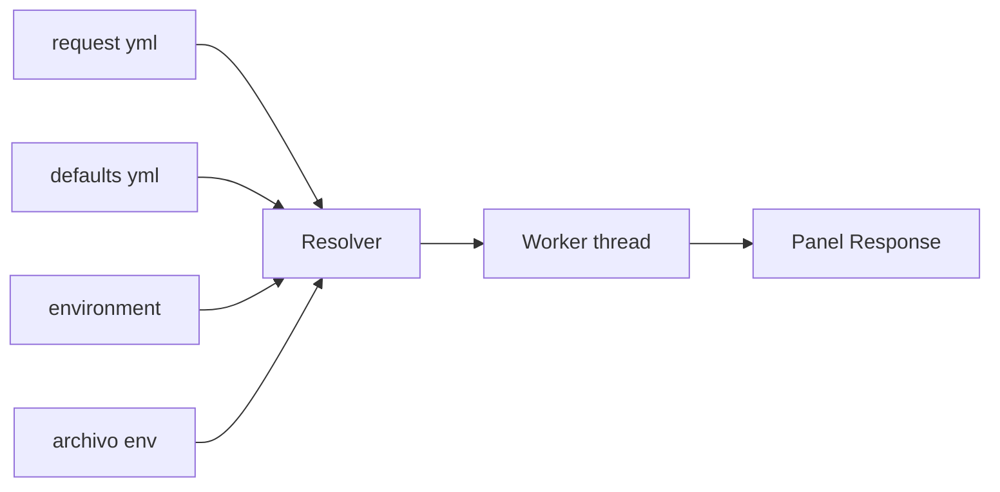

# Requests HTTP

mdnav envía requests HTTP guardados como archivos YAML, al estilo Postman o Bruno, sin salir de la terminal. Cada request es un archivo del repo: se versiona con git y se revisa en un PR como cualquier otro cambio.

## Probalo en un minuto

Esta carpeta de ejemplo trae una collection lista en `DocExample/api`. Abrila con mdnav:

```powershell
mdnav DocExample              # con mdnav instalado
cargo run -- DocExample       # desde el código, parado en la raíz del repo
```

**1. Abrí un request**

- Expandí `api` y después `ejemplos` (`j`/`k` para moverte, `Enter` para expandir).
- Seleccioná `01-get-y-cambiar-metodo.yml` y `Enter`.

El preview se parte en **Request** arriba y **Response** abajo, todavía vacía.

**2. Elegí el environment** (una sola vez: queda guardado en la config)

- `:` abre la palette. Escribí `httpenv` y `Enter`.
- Bajá hasta `public` con `j` y `Enter`.

En el panel Request, `Env` pasa a `public` y la línea `→` muestra la URL resuelta, `https://httpbin.org/anything/hola`.

**3. Enviá**

- `Shift+S`: aparece el spinner y la response llega con el JSON formateado. El foco pasa solo a la response.
- `j`/`k` hacen scroll, `]` cambia a Headers e Info, `y` copia el body y `Tab` vuelve al árbol.

**4. Cambiá algo y reenviá**

- `Shift+E` abre el YAML en tu editor. Cambiá `method: GET` por `method: POST`, guardá y salí.
- `Shift+S` de nuevo: en la response, `"method"` ahora dice `"POST"`.

Ese ciclo (editar, enviar, mirar la response) es todo el flujo de trabajo.

Para probar secretos, creá `DocExample/api/.env` con `DEMO_TOKEN=lo-que-quieras` y enviá `api/echo/post-json.yml`. httpbin devuelve el header `Authorization` que mandaste, y el token nunca aparece en el YAML.

## Ejemplos para aprender

`api/ejemplos/` tiene un request por concepto. Todos van contra httpbin, que te devuelve lo que mandaste: cambiá algo con `Shift+E`, enviá con `Shift+S` y mirá el efecto en la response. Cada archivo explica qué tocar en sus comentarios, y su sección **Docs** se ve en el panel Request.

| Archivo | Qué muestra |
|---------|-------------|
| `01-get-y-cambiar-metodo.yml` | el request mínimo y cómo pasar de GET a POST, DELETE, etc. |
| `02-query-y-path-params.yml` | `:id` en la URL, query params encodeados y apagados |
| `03-post-json.yml` | body JSON en varias líneas, con variables adentro |
| `04-post-form.yml` | body de formulario (`form-urlencoded`) |
| `05-headers.yml` | headers propios y los heredados de la collection |
| `06-token-bearer.yml` | **dónde poner tokens**: en el request, en el environment o en `.env` |
| `07-api-key-secreta.yml` | variables `secret: true` y API key en header o query |
| `08-auth-heredada/` | `folder.yml` con auth, headers y variables que heredan sus requests |
| `09-status-timeout-redirects.yml` | colores de status, timeout y redirects |

Para que los ejemplos 06 a 08 usen tus valores, creá `DocExample/api/.env` con:

```
DEMO_TOKEN=lo-que-quieras
demo_api_key=mi-clave
```

## Cómo funciona



- El resolver junta los defaults heredados (`opencollection.yml` y los `folder.yml`: variables, headers y auth), el environment activo y los secretos del `.env`.
- El request sale en un thread aparte: la UI no se congela y `Esc` lo abandona.
- La response queda en memoria por request y sobrevive a `Shift+E` (editar y volver).

## El formato: OpenCollection

Es el formato abierto que Bruno usa de forma nativa (spec en opencollection.com). Que mdnav no tenga un formato propio es a propósito: la misma carpeta se abre en Bruno, y quien no usa mdnav no queda afuera.

```
api/
├── opencollection.yml     # defaults de toda la collection
├── .env                   # secretos (gitignored)
├── environments/
│   └── public.yml
├── github/
│   ├── folder.yml         # defaults del folder
│   ├── get-user.yml
│   └── list-repos.yml
└── echo/
    ├── folder.yml         # auth bearer heredada por sus requests
    └── post-json.yml
```

## Variables y secretos

| Sintaxis | De dónde sale |
|----------|---------------|
| `{{nombre}}` | collection < environment < folders (gana el más específico) |
| `{{process.env.NOMBRE}}` | `.env` de la collection y después el entorno del proceso |
| `secret: true` en un environment | se busca por nombre en `.env` |

Una variable sin resolver aparece en **Avisos** dentro del request. Si está en la URL, el request no se envía y mdnav te pide elegir un environment.

## Teclas

| Tecla | Acción |
|-------|--------|
| `Shift+S` | enviar |
| `Tab` | árbol → request → response |
| `[` `]` / `h` `l` | tabs de la response |
| `y` | copiar el body |
| `Esc` | abandonar el request en curso |
| `Shift+E` | editar el YAML |
| `:http` | send, env, new, init, import |
| `:httpenv` | elegir environment |

## Arrancar una collection propia

- `:http` → `init` convierte la carpeta seleccionada en una collection: crea un environment `local`, el `.gitignore` del `.env` y un request de ejemplo.
- `:http` → `new` crea un request en la carpeta seleccionada.
- `:http` → `import` convierte un `*.postman_collection.json` (v2.1) en una carpeta nueva al lado del JSON. Los `*.postman_environment.json` van a `environments/`, con sus secretos pasados al `.env`.

## Límites actuales

- Los scripts y assertions no se ejecutan; se avisa cuántos hay. Los scripts de Postman quedan como documentación del request.
- Sin bodies multipart ni file, y sin auth OAuth, AWS, digest ni NTLM.

## Siguiente

- [Volver a navegación](02-NAVIGATION.md)
- [Volver al inicio](../00-INTRO.md)
